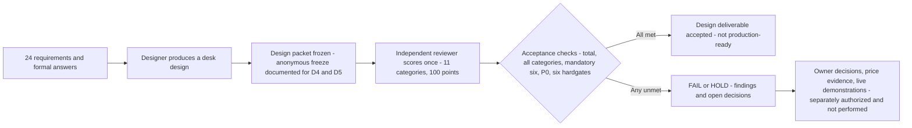

# Level3 Cloud Architecture Thought Experiment: Desk-Design Evaluation

[日本語](README.ja.md) | English

> **Reader note (2026-10-14).** The summary, Level explanation, trial table, diagram, acceptance table, and code guide below were added on 2026-10-14 to help new readers. No experiment, scoring, or cloud work was done for this edit. Every score, date, and caveat comes from the earlier records linked on this page.

## 📌 Summary (conclusion first)

**Question investigated.** Can an AI agent turn ambiguous business requirements into a defensible AWS / Azure / GCP architecture, when judged against a fixed rubric?

**Main conclusion.** While the design became progressively more concrete, no trial met the fixed acceptance conditions. The latest formal result is **D5 (2 Oct 2026): independent score 77/100, numerical FAIL, adoption HOLD** ([D5 report](docs/reports/2026-10-02-d5/FINAL-REPORT.en.md)). The highest independent score is D4 at 78 (1 Oct). The independent series 53 → 72 → 69 → 78 → 77 is not monotonic ([discussion](docs/reports/2026-10-02-d5/DISCUSSION.en.md)).

**What was demonstrated.** Design documentation and evidence mapping on paper:

- All 24 fixed requirements traced to design decisions, with answers already given by the business kept apart from open questions.
- A ledger of unknown costs (U) that never turns a missing price into zero.
- Concrete IAM, deletion, and recovery specifications, and 35 failure, cost, and operations scenarios reviewed on paper.
- Scoring by a reviewer separate from the designer, with the rubric and pass conditions left unchanged.

This is **not** a live success. Nothing was deployed in the scored trials, and no infrastructure performance, recovery, deletion, or bill was measured.

**Judgments only humans can supply.** These are decisions about the business, not outputs of a model:

- **Data and deletion duties:** what starts the deletion clock, how long minimal linking information may be kept, and who is responsible for copies held by recipients or vendors.
- **Named owners and staffing:** accountable primary and deputy people, approved working hours, and coverage when they are absent.
- **Authority:** who has pre-approved authority for unattended recovery.
- **Budget:** headroom for mandatory residual costs, invoice exchange rate and tax, and development hours.

**Remaining gaps.**

- Cost scored 3, below the mandatory minimum of 4. Hardgates G3 and G4 are on HOLD. Complexity 3 meets the general floor but lowers the weighted total.
- Owner, source-access, and unauthorized-live prerequisites are unresolved. These are adoption prerequisites, not desk-design defects.
- Actual runtime models and reasoning settings are UNKNOWN in every trial.
- A desk design cannot prove live infrastructure, SLO attainment, deletion, bills, or legal compliance.

## Where Level 3 sits

The repository owner groups their validations into three levels as a project-specific framing, inspired by how cloud vendors' certification paths progress. It is **not** an official vendor-wide three-tier scheme, not coverage of any exam's scope, and not equivalent to any certification.

| Level | Focus in this project | Status relative to this repository |
|---|---|---|
| 1 | Foundational | Outside this repository |
| 2 | Intermediate: administration and operations | A separate repository, [Level 2 multi-cloud Terraform validation](https://github.com/moruku36/cloud-validation-level2-multicloud). Its own report describes work in short-lived disposable cloud environments. None of that applies to Level 3 |
| 3 | Advanced: architecture decisions | **This repository.** Desk design and independent paper assessment only |

## Scope: desk design only

The scored October trials are desk designs: no environment was deployed and no live infrastructure performance, recovery, or bills were measured in them. In September, C-1 separately made a read-only look at an existing authenticated console; it changed nothing and stopped incomplete. Reading this repository needs no cloud access. Local document or implementation work is not infrastructure acceptance, and a design-only assessment cannot prove live infrastructure, SLO attainment, deletion, bills, or legal compliance.

## Trial overview

"Requested model setting" is what was asked for, not a verified runtime. Self-assessed scores (the same agent that did the work) must not be mixed with independent scores (a reviewer separate from the designer).

| Date (2026) | Plain name | Code | Requested model setting (unverified) | Assessment | Result | Records |
|---|---|---|---|---|---|---|
| 8–9 Sep | Single-cloud (AWS) design and review | A (A-1 to A-3) | GPT-6 Astra Light, as specified; runtime not identified | Self | 61 → 65, below the bar; adoption on hold ❌ | [A report](experiments/A/final-report.md), [scores](experiments/A/A-3/scores.md) |
| 10 Sep | Three-provider comparison and selection design | B (B-1 to B-3) | GPT-6 Astra Light, as specified; runtime not identified | Self | 66 at every stage (initial, B-2 complete, B-3 limited fix); design FAIL; AWS only a reference preference; selection on hold ❌ | [B report](experiments/B/final-report.md) |
| 13 Sep | Read-only console check | C-1 | Not applicable (no design scoring) | None | INCOMPLETE; nothing changed ⏸ | [C-1 record](evaluation/C-1-console-readonly-check-run.md) |
| 1 Oct (individual clock unknown) | First independent desk trial | D1 | GPT-6 Luna Low | Independent | 53; gates 2 PASS / 3 FAIL / 1 UNKNOWN ❌ | [D1–D4 report](docs/reports/2026-10-02-final/FINAL-REPORT.en.md) |
| 1 Oct (individual clock unknown) | Second independent desk trial | D2 | GPT-6 Luna Medium | Independent | 72; gates 4 PASS / 2 UNKNOWN ❌ | same |
| 1 Oct (individual clock unknown) | Third independent desk trial | D3 | GPT-6 Luna High | Independent | 69; gates 4 PASS / 2 HOLD ❌ | same |
| 1 Oct | Fourth independent desk trial (highest score) | D4 | GPT-6.1 Sol Medium | Independent | **78**; gates 4 PASS / 2 HOLD; Cost 3 ❌ | same, [D4 clocks](docs/reports/2026-10-02-d5/evidence/inherited/independent-review-D4/metadata-clocks.json) |
| 2 Oct | Single inherited improvement trial (latest formal result) | D5 | Designer GPT-6.1 Sol High; reviewer GPT-6.1 Sol Medium | Independent | **77**; numerical FAIL; adoption HOLD ❌ | [D5 report](docs/reports/2026-10-02-d5/FINAL-REPORT.en.md) |
| Reported 2 Oct | Separate fresh trial | Not coded | Reported as Sol High; not verified | Independent (reported) | 73; known only from the publication handoff; **not** in the D1–D5 series | [discussion](docs/reports/2026-10-02-d5/DISCUSSION.en.md) |
| 2 Oct | Changed requirements (90-day backups, 14-day PITR, automated regional recovery, and others) | Not coded | Not applicable | None | Unscored; not D5 input | [final report](docs/reports/2026-10-02-final/FINAL-REPORT.en.md) |
| Not scheduled | Opus 5.5 High/Medium additional pilot | Not coded | Planned labels only | None yet | Planned, not executed ⏸ | [pilot plan](docs/research/OPUS55-PILOT-PLAN.en.md) |

All October trials are desk-only. The individual clocks for D1–D3 are unknown; only the D4 clocks (1 Oct) are public.

## Evaluation flow

*Figure: desk-design assessment flow; not deployed infrastructure. It describes the October independent trials. The September A and B stages were self-assessed.*

## Acceptance conditions and the D5 result

A pass would mean acceptance of a design deliverable against fixed conditions. It would not mean production readiness.

| Condition | Required | D5 result |
|---|---|---|
| Total score | At least 80 | ❌ 77 |
| All 11 categories | At least 3 each | ✅ minimum 3 |
| Six mandatory categories (Requirements, Architecture, Security/IAM, Availability, Cost, Backup/DR) | At least 4 each | ❌ Cost 3; the other five 4 |
| Unresolved P0 | None | ❌ owner, source-access, and unauthorized-live adoption prerequisites remain; no desk-design P0 was identified |
| Six hardgates | All PASS | ❌ G1, G2, G5, G6 PASS; G3 and G4 HOLD |

Complexity 3 meets the general floor of 3 but lowers the weighted total; it is not by itself a mandatory-4 failure. The D5 evidence records a total of 77 in [scoring.csv](docs/reports/2026-10-02-d5/evidence/independent-review-D5/scoring.csv), with the reviewer separate from the designer and the human scoring column blank ([gates](docs/reports/2026-10-02-d5/evidence/independent-review-D5/gates.csv)).

## Codes you will meet

Do not infer expansions for these codes; the [glossary](docs/glossary.en.md) gives the meaning each source defines.

| Code | What it is | What it is not |
|---|---|---|
| A, B, C, C-1 | September workflow stages: A single-cloud design, B three-provider comparison and selection, C a planned empirical stage; C-1 is the read-only console check | Not the two research phases, and not model names |
| D1–D5 | Trial identifiers in the October series. D5's formal report title is "single inherited improvement trial" | Not the "D" (Design Feedback) task label from September |
| T01–T16 | Validation tests planned for a future empirical stage | Not scored design trials, and none was executed. Separate from requirements diagram node IDs (T1–T5; T5 = securing scale-up/out headroom, an example decomposition, not a deployed design); for two "T05" variants see glossary |
| S01–S35 | Failure, cost, and operations review scenarios assessed on paper in D5 | Not live tests |
| G1–G6 | The six hardgates used in D5 scoring. G3 is all-copy deletion, backup, ledger, and audit; G4 is owners, hours, coverage, and unattended recovery | Not the C-1 execution gates G0–G11, and not the B-2 limited-completion groups G1–G4 |
| REQ-01–24 | The 24 fixed requirement IDs | |
| U | Unknown or unsettled cost items; never treated as zero | |
| P0 / P1 / P2 | Finding priority levels | |

## Two research phases

- **September, initial attempt (self-assessed).** A-1 (8 Sep), A-2/A-3 (9 Sep) and B (10 Sep) produced self-scores of 61 → 65 (A) and 66 (B). The reports themselves record the shortcomings: omitted monitoring costs, and unproven deletion deadlines, recovery, and ownership/staffing constraints. C-1 (13 Sep) stopped incomplete. These are a different method from October, so the scores are not comparable ([A](experiments/A/final-report.md), [B](experiments/B/final-report.md), [C-1](evaluation/C-1-console-readonly-check-run.md)). Full English counterparts of the A and B reports are in [A English report](experiments/A/final-report.en.md) and [B English report](experiments/B/final-report.en.md).
- **October, independent follow-up (1–2 Oct).** Independent review replaced self-scoring. Requirements/evidence mapping, an unknown-cost (U) ledger, and the IAM, deletion, and recovery specifics became more concrete, but nothing was proven live. The highest independent score is 78 (D4) and the latest is D5 at 77 (requested High). The separate fresh trial (73) and the unscored changed requirements are not part of this series. Actual models and applied reasoning settings are UNKNOWN.

## Reading path

1. This README: purpose, result, which record to trust.
2. [Methods and results](docs/research/METHODS-RESULTS.en.md): the September failures, the October follow-up, remaining limitations, and the proposed controlled next research.
3. [Evidence appendix](docs/research/EVIDENCE.en.md): a curated index of sources, with scope gaps stated.
4. [Glossary](docs/glossary.en.md): what each code means and which source defines it.
5. [Opus 5.5 High/Medium additional pilot plan](docs/research/OPUS55-PILOT-PLAN.en.md): planned, not executed, date undecided. Not permission to start.

## Which record to trust

- **Authoritative latest:** D5 (2 Oct 2026, independent review).
- **Historical appendices:** the September A/B/C-1 workflow stages and the D1–D4 trials. The letters A/B/C are historical workflow stages, not the two research phases.
- **Separately unscored:** the requirements changed on 2 Oct (90-day backups, 14-day PITR, automated regional recovery, and others) in the [final report](docs/reports/2026-10-02-final/FINAL-REPORT.en.md). They were not D5 input, and their existence is not evidence of a pass.
- **Reported context only:** a separate fresh-trial score of 73, known only from the publication handoff. It is excluded from the D1–D5 series.

## ⚠️ Caveats

Model names are requested settings, not verified runtimes. D5 requested a Sol High designer and a Sol Medium reviewer, and the actual models and settings are UNKNOWN. The results therefore show neither a causal model comparison nor the limits of current frontier models.

**Attribution.** These records do not establish a precise allocation of tools or operators across stages, and the actual runtime models are UNKNOWN. In particular, the October records do not document which parts were done by Codex, by other tools, or by the repository owner individually. Applicants should confirm this before attributing any of the work to Codex or to a person.

**What this does not show.** These results do not show that AI replaces cloud architects, and they do not show production readiness. They show how far a desk design can go, and which business decisions and evidence it still depends on.

Historical experiment reports, evaluation records, and frozen publication packages are preserved. The older B and C-1 navigation guides now point here. Older wording about next actions in archival reports is historical, not current authorization.
