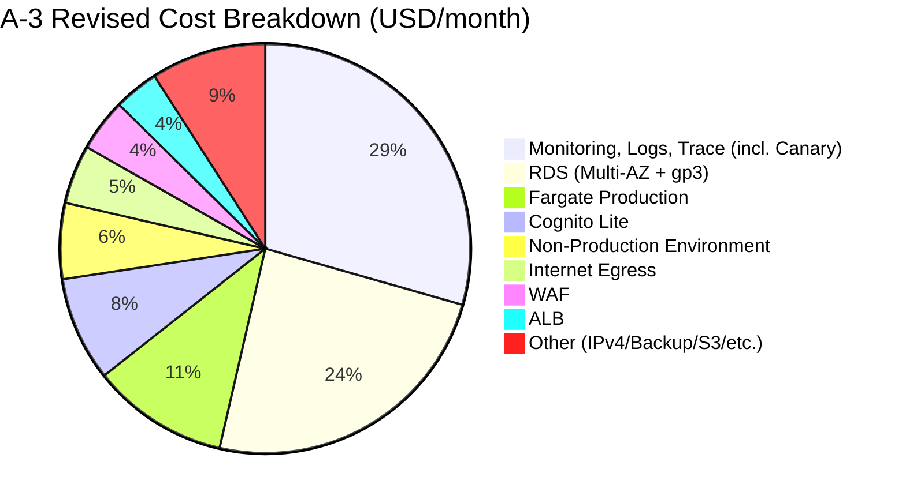

# Cloud Validation LEVEL3-A Detailed Results Report

[日本語](final-report.md) | English · [Overview](../../README.md)

> **Reader note (2026-10-14).** This document is the full English counterpart of the original Stage A detailed results report from 2026-09-09 ("A" refers to a historical workflow stage, not the September/October research phases). All numbers, dates, caveats, links, and evaluations are faithfully preserved. For the latest research results and overall repository guide, see the [README](../../README.md).

Date of creation: 2026-09-09 (JST). Scope: A-1 to A-3, completed at A-3 commit [68e4607](https://github.com/moruku36/cloud-validation-level3-astra-light/commit/68e4607). Consolidates existing materials only; no new design, comparison, scoring, specification/pricing research, or testing was performed.

**The A-1 to A-3 workflow stages are complete. Self-assessment scored 61 → 65, failing acceptance criteria and leaving adoption approval on hold. Cloud resource deployment and performance/failure testing were not executed. Progression to B-1 remains on hold.** Grounds: [Scores](A-3/scores.md), [24 Requirements Evaluation](A-3/traceability.md).

“Fact” refers to items verified in records, “Contemporary judgment” refers to design, assumptions, and scoring at each stage, and “Present reflection” refers to interpreting them. Reflection is not substituted for measurement or rescoring.

## 1. Experimental Overview

| Item | Verified Content |
|---|---|
| Purpose | Determine a rational cloud architecture from ambiguous requirements; evaluate deficiency discovery, comparison, feasibility, justification, and change responsiveness |
| Scope | A-1 requirements formalization, A-2 AWS design, A-3 design review. No detailed IaC/application implementation, resource creation, or load/failure testing |
| Specified model | GPT-6 Astra Light |
| Runtime model identification & version | Not acquired. The specified name is not treated as a verified measurement |
| Reasoning settings, temperature, seed, context limit | Unknown due to insufficient records |
| Concurrency | Subagents not used; executed sequentially stage by stage |
| Execution dates | A-1: 2026-09-08, A-2/A-3: 2026-09-09. Based on document and Git records |
| Tools used | Shell via Codex, Git, GitHub CLI / connection search, web search/viewing, browser shared chat body retrieval, curl, Python price extraction and document/arithmetic checking, Mermaid diagram source |
| Present task | Git/gh check of PRs, Issues, and history; reading and aggregating existing files only. No new specification or pricing research |

Sources: [Execution Policy](../../docs/execution-policy.md), [Supplementary Requirements](../../docs/sources/supplement-2026-09-08.md), [A-2 Operations](../../evaluation/A-2-run.md), [A-3 Operations](../../evaluation/A-3-run.md). Given unverified model settings, execution on a specific model is not definitively asserted.

## 2. Input Requirements and Human Supplementation

The initial intake was a domestic B2C service, initial 10k / future 1M users, 1M PV/month, personal data, 24/7/365, availability 99.9%+, RTO 30 min / RPO 5 min, 5 developers / 1 dedicated infra engineer, monthly budget within 100,000 JPY. Functions, peak profile, retention, failure scope, expense items, and nighttime response were unknown, and no products or instance counts were specified. ([Initial Intake](../../evaluation/A-1-intake.md))

While storage location, publication scope, and original source text were unspecified, dependent work remained on hold. A human designated the public GitHub repository and shared chat, but full contents including scoring points could not be acquired from the shared page, and official supplementation was received subsequently. Complete acquisition of the original source is not claimed. ([Preparation Record](../../evaluation/repository-preparation.md), [Retrieved Text](../../docs/sources/shared-chat.txt), [Official Supplement](../../docs/sources/supplement-2026-09-08.md))

| Question | Verification Subject | Official Experimental Answer |
|---|---|---|
| Q01 | Functions, processing, and delivery | Registration, login, profile, list/detail views, favorites, admin updates; images and email. Payments etc. excluded; updates reflected in user's next read |
| Q02 | Load and performance | Dynamic 10 RPS normal / 100 RPS peak for 15 min, 500 concurrent users, 9:1 read/write, p95 ≤ 500 ms, server error rate < 1%, static separate |
| Q03 | Data, retention, and deletion | Business data 20 GB + 2 GB/month, images 100 GB + 10 GB/month, egress 200 GB/month. Domestic storage, deletion within 30 days of withdrawal, backup 35 days max, re-deletion after restore |
| Q04 | Availability | Core functions calendar month 99.9%+, including planned downtime and dependency failures, measured via external E2E at ingress. Admin and email delays monitored separately |
| Q05 | Recovery | Recovery from process/platform/DB/single-AZ failures within 30 min from impact to end of 5-min stabilization; gap to confirmed data ≤ 5 min. Logical corruption 4h provisional; regional outage separate |
| Q06 | Budget scope | Production + minimal non-production within 100,000 JPY/month incl. tax; mandatory costs included, specified exclusions; independent of free tiers/long-term discounts; Phase C budget separate |
| Q07 | Staffing and experience | Daytime response, no night SLA; basic Web/GitHub/cloud/IaC experience, no production Kubernetes experience, no incumbent vendor preference |
| Q08 | Growth | 1 million users in ~3 years, independent of 10x traffic bursts. Future budget undecided; initial cap not applied to growth |

The [Official Answers](../../docs/sources/business-answers-2026-09-08.md) represent experimental common constraints rather than facts of a live service. They can be traced to the [Mapping Table](A-1/questions.md), [24 Requirements and Acceptance Criteria](A-1/requirements.md), and [Issue #2](https://github.com/moruku36/cloud-validation-level3-astra-light/issues/2).

The human instruction limiting the design to AWS applied only to Phase A, and was not steering toward Fargate, SQL, or instance counts. An exchange rate of 150 JPY/USD, 10% tax, 20% contingency, 730 hours/month, 1 daily peak, 10 RPS continuous daily load, 2 KB API responses, 10k MAU, 10k emails/month, 100 RPS per task, and ledger retention were AI calculation and design assumptions. 500 concurrent users was not treated as synonymous with TCP connections, and 1 million users was not converted into a 100x increase in RPS. ([Assumptions](A-1/assumptions-risks.md), [Cost Conditions](A-2/cost.md), [Revised Specifications](A-3/revised-design.md))

## 3. Results, Completion Criteria, and Evidence by Stage

| Stage | Input / Activity | Deliverables and Completion Criteria | Outcome / Version |
|---|---|---|---|
| Preparation | Storage location, partial original text, official supplement | Saving source, execution policy, and handoff to GitHub | [PR #1](https://github.com/moruku36/cloud-validation-level3-astra-light/pull/1), supplement fb86c54 |
| A-1 Initial | Ambiguous requirements | 22 requirements, 8 questions; awaiting answer explicitly stated | Incomplete as of [6731042](https://github.com/moruku36/cloud-validation-level3-astra-light/commit/6731042) |
| A-1 Answer Integration | Official answers | 24 requirements, acceptance criteria, major gaps resolved, remote push, Issue closed | [PR #3](https://github.com/moruku36/cloud-validation-level3-astra-light/pull/3), completed at [1745dfe](https://github.com/moruku36/cloud-validation-level3-astra-light/commit/1745dfe) |
| A-2 | 24 requirements / Issue #4 | 3 candidate options, selection/rejection, diagram, costs, sources, operations/DR/IaC policy saved | Initial [81cab82](https://github.com/moruku36/cloud-validation-level3-astra-light/commit/81cab82), completed at [b5f5022](https://github.com/moruku36/cloud-validation-level3-astra-light/commit/b5f5022), [PR #5](https://github.com/moruku36/cloud-validation-level3-astra-light/pull/5) |
| A-3 | A-2, rubric, focused review | 24 requirements evaluation, F01–F07 findings, revisions, scoring, unverified items / handoff saved | [8870250](https://github.com/moruku36/cloud-validation-level3-astra-light/commit/8870250), completed at [68e4607](https://github.com/moruku36/cloud-validation-level3-astra-light/commit/68e4607), [PR #6](https://github.com/moruku36/cloud-validation-level3-astra-light/pull/6) |

Stage completion signifies the completion and preservation of deliverables, not successful live service operation. ([A-1 Completion Record](../../evaluation/A-1-completion.md), [A-2 Record](../../evaluation/A-2-run.md), [A-3 Record](../../evaluation/A-3-run.md))

Git author timestamps (JST): A-1 initial 09/08 16:47:10, completed 16:59:36; A-2 initial 09/09 09:06:11, completed 09:10:14; A-3 review 09:25:31, completed 09:26:49. Actual working time is not inferred from these timestamp differences. Conversations involved reconnecting across calendar days, and commit timestamps do not necessarily match network communication completion times.

At verification time, PRs #1, #3, #5, and #6 were OPEN and unmerged. The dependency chain was `main ← prep/requirements-intake (#1) ← a1/requirements (#3) ← a2/aws-design (#5) ← a3/aws-review (#6)`. The report branched from a3/aws-review and does not reference main in isolation.

## 4. Architecture Judgments

The following summarizes contemporary judgments; options were not re-selected for this report.

| Candidate Option | Rationale | Trade-offs / Unverified Aspects |
|---|---|---|
| ECS/Fargate ARM + RDS PostgreSQL Multi-AZ | Conditionally adopted. Reduces OS maintenance, ensures SQL consistency, active 2AZ/synchronous standby reduces human recovery dependency | Fixed costs, single writer, CPU credits, single-task performance, auth-dependent RTO, all cost categories unsettled |
| EC2 Auto Scaling + RDS | Rejected because OS/AMI patching and launch replenishment would burden the single dedicated engineer | Price comparison incomplete. Could be reversed with mature operations and significant cost savings |
| Regional REST API Gateway + Lambda + DynamoDB | Strong alternative, but initially rejected due to cold starts, query/index flexibility, consistency, and migration overhead | Lacks comparable confirmed estimate; cost advantage conclusion remains unsettled |

[Comparison and Design](A-2/design.md), [ADR with Requirement IDs](../../docs/decisions/ADR-A2-001.md), [Architecture Diagram](A-2/diagram.md), [Recovery/Operations/IaC](A-2/recovery-operations.md). In Tokyo 2AZ: ALB/WAF, 1 vCPU / 2 GB Fargate task in each AZ, RDS t4g.medium / 50 GB gp3 synchronous Multi-AZ. Task public IPs accept ingress only from ALB SG; DB and S3 are private. CloudFront initially rejected due to lack of domestic cache retention guarantee; Cognito and SES in Tokyo with cold DR in Osaka. Kubernetes rejected due to lack of business necessity and staffing constraints.

The compute platform and instance sizing remained unchanged after revision. Additions included monitoring quantity/cost, stabilization validation, task placement checking, deletion verification, unapproved ledger disclosure, TLS boundaries, and worker isolation. ([F01–F07](A-3/review.md), [Revised Specification](A-3/revised-design.md)). The final state was approval withheld on a conditional proposal.

**Present reflection:** While selection reasons for SQL and operational simplicity were articulated, confirmed pricing and performance evidence for alternatives were lacking. Optimal configuration was not demonstrated, consistent with the existing A-3 Architecture score of 3 points.

## 5. Cost Estimate Changes

Rows in the existing cost tables were audited. Units: USD/month; JPY conversion: USD × 150 × 1.10; contingency: additional × 1.20. Free tiers, credits, and long-term discounts were not deducted. Assumptions represent production + minimal non-production, not live empirical expenses.

| Expense Category | End of A-2 | A-3 Revised | Difference | Classification |
|---|---:|---:|---:|---|
| Fargate ARM Production | 71.96 | 71.96 | +0.00 | Unchanged; no additional quantity/price verification |
| RDS Multi-AZ | 147.46 | 147.46 | +0.00 | Unchanged; no additional quantity/price verification |
| RDS gp3 | 13.80 | 13.80 | +0.00 | Unchanged; no additional quantity/price verification |
| ALB | 23.58 | 23.58 | +0.00 | Unchanged; no additional quantity/price verification |
| Public IPv4 | 14.60 | 14.60 | +0.00 | Unchanged; no additional quantity/price verification |
| WAF | 27.70 | 27.70 | +0.00 | Unchanged; no additional quantity/price verification |
| Cognito Lite | 55.00 | 55.00 | +0.00 | Unchanged; no additional quantity/price verification |
| S3 Storage & Requests | 6.00 | 6.00 | +0.00 | Unchanged; no additional quantity/price verification |
| SES | 2.00 | 2.00 | +0.00 | Unchanged; no additional quantity/price verification |
| Internet Egress | 31.00 | 31.00 | +0.00 | Unchanged; no additional quantity/price verification |
| Monitoring, Logs, Trace | 30.00 | 196.44 | +166.44 | Execution fee omission corrected; minimum checks clarified |
| Security | 10.00 | 10.00 | +0.00 | Unchanged; no additional quantity/price verification |
| Backup & Osaka Copy | 16.00 | 16.00 | +0.00 | Unchanged; no additional quantity/price verification |
| Non-Production | 40.00 | 40.00 | +0.00 | Unchanged; no additional quantity/price verification |
| Inter-AZ Traffic | 6.00 | 6.00 | +0.00 | Unchanged; no additional quantity/price verification |
| ECR & CI | 3.00 | 3.00 | +0.00 | Unchanged; no additional quantity/price verification |
| DNS & Other | 3.00 | 3.00 | +0.00 | Unchanged; no additional quantity/price verification |
| Total | 501.10 | 667.54 | +166.44 | Increase in monitoring costs only |

Sources: [Former Cost Table](A-2/cost.md), [Revised Cost Table](A-3/budget.md), [Official Canary Pricing Extraction](A-3/canary-prices.json).

- **Omitted estimate:** Added canary charge of 1 canary in Tokyo and 1 in Osaka × 60 runs/hour × 730 hours × 0.0019 USD = 166.44 USD. The previous 30 USD was retained as other monitoring, totaling 196.44 USD. Details of the remaining 30 USD are unsettled and sufficiency is not guaranteed.
- **Clarification of quantity:** Implementing independent canaries "per function" from A-2 would increase the check count. A-3 represents the minimum option of 1 multi-step canary per region. Because A-2 lacked an explicit quantity, no claim of "reducing checks" is inferred.
- **Design change:** The difference stems from clarifying monitoring steps and controls, not adding compute nodes. Additional operational costs from other revisions were not quantified.
- **Display correction:** The initial commit 81cab82 contained a discrepancy between handwritten figures (99k/119k JPY) and the calculation table, corrected to 82.7k/99.2k JPY in [ad0fb7d](https://github.com/moruku36/cloud-validation-level3-astra-light/commit/ad0fb7d). This was separate from the canary omission. "Initial 82.7k/99.2k JPY" was the reported figure at the end of A-2; not all statements in the first draft had matched. ([Correction Record](../../evaluation/A-2-run.md))

| Version | Contingency | Monthly Total Incl. Tax (Unrounded → Display) | Difference from 100k JPY | Overage Rate |
|---|---|---:|---:|---:|
| A-2 | None | 82,681.50 → 82,682 JPY | 17,318.50 JPY headroom | None |
| A-2 | 20% | 99,217.80 → 99,218 JPY | 782.20 JPY headroom | None |
| A-3 | None | 110,144.10 → 110,144 JPY | 10,144.10 JPY over budget | 10.1441% |
| A-3 | 20% | 132,172.92 → 132,173 JPY | 32,172.92 JPY over budget | 32.17292% |

### Monthly Cost vs. Budget Cap Comparison (Incl. Tax)

| Case | Amount (JPY) | Status Relative to Budget (100,000 JPY) |
|---|---:|---|
| **A-2 (No contingency)** | 82,682 JPY | `[■■■■■■■■            ] 82.7%` (17.3k JPY headroom) |
| **A-2 (20% contingency)** | 99,218 JPY | `[■■■■■■■■■■          ] 99.2%` (782 JPY headroom) |
| **Budget Cap** | **100,000 JPY** | `[■■■■■■■■■■          ] 100.0% Baseline` |
| **A-3 (No contingency)** | 110,144 JPY | `[■■■■■■■■■■■         ] 110.1%` (**10.1k JPY over**) |
| **A-3 (20% contingency)** | 132,173 JPY | `[■■■■■■■■■■■■■       ] 132.2%` (**32.2k JPY over**) |

### A-3 Revised Monthly Cost Breakdown (Total: 667.54 USD)

The difference is 27,462.60 JPY without contingency, and 32,955.12 JPY with contingency. Discrepancies between integer display values (27,462 / 32,955 JPY) are due to rounding, not new expense items. The 0.0046 USD difference between the unrounded A-2 sum (501.0954 USD) and displayed line-item total (501.10 USD) was noted in earlier audits. Verification here follows the displayed line-item totals; historical tables are not altered.

The 730-hour billing assumption is distinct from the 30-day page view traffic model. An exchange rate of 150 JPY/USD and 10% tax are planning assumptions, not verified values from invoices or market rates. Foreign exchange breakeven thresholds were 181.42 JPY (no contingency) / 151.18 JPY (20%) under the former estimate, shifting to 136.19 JPY / 113.49 JPY in the revised edition. Increasing API responses from 2 KB to 20 KB would add ~510 GB and 61.2 USD under existing assumptions. ([Existing Sensitivity Analysis](A-3/budget.md))

Minor items, effective backup volume, Internet egress rates, non-production billing granularity, and scale/CPU credits remain unsettled. "Unchanged" does not mean accuracy has been verified. Replacing monitoring, changing probe frequency, downsizing tasks, and altering budget caps were contemporary unadopted ideas and are not adopted here.

## 6. Evaluation Results (Transcription and Arithmetic Check Only)

| Category | Weight | Initial | Revised | Weighted Initial → Revised | Contemporary Short Rationale |
|---|---:|---:|---:|---:|---|
| Requirements Understanding | 15 | 4 | 4 | 12 → 12 | Understood requirement figures and boundaries → Evaluated 24 requirements without relaxing criteria |
| Architecture Feasibility | 15 | 3 | 3 | 9 → 9 | Rationale provided for candidates, but alternative costs unsettled → Baseline retained; superiority unproven |
| Security & IAM | 10 | 3 | 3 | 6 → 6 | PII ledger and transfer unverified → Corrected TLS/audit limits; retention unapproved |
| Availability | 10 | 3 | 3 | 6 → 6 | Dependency recovery within 30 min and single-AZ capacity unproven → Corrected stabilization measurement; dependency gaps remain |
| Scalability | 5 | 3 | 3 | 3 → 3 | Workload separation present, but capacity evidence lacking → Same; no empirical measurements |
| Cost | 10 | 2 | 3 | 4 → 6 | Significant monitoring omission, rough estimates → Official canary pricing and sensitivity added; budget exceeded |
| Operations | 10 | 3 | 3 | 6 → 6 | Engineer workload and deletion operations unformalized → Added failure verification; staffing viability evidence lacking |
| Backup & DR | 10 | 3 | 3 | 6 → 6 | Deletion deadlines/ledger and recovery gaps → Deletion proposal reinforced; 4h/regional recovery unproven |
| Observability | 5 | 2 | 4 | 2 → 4 | Cost discrepancy and 5 runs = 5 min error → Multi-step, real-time 300s, missing data/cost clarified |
| Complexity | 5 | 4 | 4 | 4 → 4 | Clear rationale for small-scale managed setup → Same; additional batch job overhead disclosed |
| Vendor Lock-in & Portability | 5 | 3 | 3 | 3 → 3 | SQL/containers portable; auth migration weak → Same; auth salvage unformalized |

Total weight: 100 points. Σ (Weight × Score ÷ 5) = 61 → 65. Increases came solely from Cost (+2 weighted) and Observability (+2 weighted). ([Original Scoring and Grounds](A-3/scores.md), [Weights, 5-point Scale, and Acceptance Criteria](../../docs/sources/supplement-2026-09-08.md)). No rescoring was performed here, and no calculation errors were found.

| Condition | Initial | Revised |
|---|---|---|
| Total score ≥ 80 | 61, Failed | 65, Failed |
| All categories ≥ 3 | Cost / Observability scored 2, Failed | Satisfied |
| Requirements, Architecture, Security, Availability, Cost, DR each ≥ 4 | All except Requirements failed | All except Requirements failed |
| Unmet/unverified items disclosed and traceable | Monitoring cost omission present initially | Self-assessed as disclosed and traceable |
| Human scoring and adoption approval | Not executed | Not executed; on hold |

A-3 stage completion, failure to meet acceptance criteria, and withholding of human adoption approval are distinct. The improvement in Cost reflected clarifying reasons for budget failure rather than achieving budget compliance; Observability 4 reflected concrete design rather than live measurement 5. The human scoring column remains blank.

## 7. Discovered Issues and Open Tasks

| Issue | Discovered / Explicit Stage & Evidence | Impact and Treatment | Reason Unresolved |
|---|---|---|---|
| Monitoring cost omission | A-3 F01, official unit price 166.44 USD | Monitoring adjusted to 196.44 USD; budget exceeded | All cost categories unsettled; no decision on budget vs. reductions |
| 5-minute stabilization check | A-3 F02, 5 runs/min could equate to 4 min | 300 seconds, 6 observations; reset on missed/failed checks | Accuracy during actual implementation/outages unverified |
| All-dependency recovery | Limits disclosed in A-2, A-3 dependency table | Auth, DNS, routing, and DB reconnection decoupled; JWT not treated as login recovery | Internal limits and E2E demonstration lacking |
| Single-AZ performance & placement | A-2 assumption, A-3 F03 | Healthy task inspection, automatic redeployment, capacity test criteria | 100 RPS/task and launch/placement unmeasured |
| Email storage & transfer | Unverified in A-2, formalized in A-3 | Tokyo SES decoupled from recipient side; unmet if domestic storage applies to all copies | Recipient destinations and boundary unconfirmed |
| Withdrawal / deletion ledger | Proposed in A-2, A-3 F05 | 42-day ledger retention not treated as approved exception to 30-day deletion | Retention necessity, re-identification risk, restore testing incomplete |
| Expiry deletion | A-3 F04, asynchronous lifecycle | Pre-expiry batch job; version/copy/snapshot reconciliation | Physical deletion within 35 days unproven |
| TLS description | A-3 F06, target certificate unverified | Encryption decoupled from peer authentication; SG and registration role boundaries | Implementation and permission checks lacking; description corrected only |
| Worker contention | A-3 F07, shared task usage | Concurrency, timeout, and retry limits imposed | Simultaneous API performance testing lacking |

Sources: [F01–F07](A-3/review.md), [Revised Dependency/Storage Table](A-3/revised-design.md), [Former Issue Assessment](A-2/issue4.md), [Issue #4](https://github.com/moruku36/cloud-validation-level3-astra-light/issues/4). The Issue is OPEN; document corrections and arithmetic checks were resolved, but budget, recovery, and data compliance remain unresolved.

## 8. Human Intervention and AI Autonomy

| Classification | Recorded Count | Treatment |
|---|---|---|
| Requirements answers | 3 times: storage location etc., official supplement, official business answers | Counted as 1 per message; 8 items not counted as 8 separate interventions |
| Specific design hints or steering | 0 recorded | Restriction to AWS was an experimental constraint, distinct from steering product selection |
| Review focus additions | 1 time: A-3 focused review instruction | Human designated costs, recovery, and personal data as focus areas |
| Direct human design revisions | 0 recorded | F01–F07 were revised by AI following instructions |
| Direct human code/config modifications | 0 recorded | Implementation stage not executed |
| Working and review time | Not acquired | Commit timestamps and tool latencies not converted to working time |
| Token usage, remaining tokens, model fees | Not acquired | Estimates not treated as measured values |
| Present request | Report generation | Not added to requirements answers, design steering, or rescoring |

[Intervention Ledger](../../evaluation/human-intervention.md). Counts reflect enumeration of available conversations and ledgers, not automated telemetry across all sessions. Interventions from other conversations were not acquired.

**Fact:** The AI organized questions and assumptions in A-1, and documented selection rationales and certain unconfirmed items in A-2. However, it overlooked the monitoring omission in A-2 during self-inspection. After a human directed the focused review in A-3, the AI specifically identified unit price omissions, stabilization validation, deletion, and TLS boundaries. Autonomous discovery of all issues without prompt guidance is not claimed. ([A-2 Operations](../../evaluation/A-2-run.md), [A-3 Operations](../../evaluation/A-3-run.md))

**Present reflection:** While requirement structuring and documentation progressed, overlooking rough cost categories altered the budget conclusion. Significant constraints remained even after instructed revisions. General capabilities or success rates across models cannot be generalized from a single instance with unverified model identification and human supplementation.

Operational errors are also distinguished from design tests. [Preparation Records](../../evaluation/repository-preparation.md) show uninitialized Git, restricted authentication failures, shared chat export failures, workflow scope push rejections, and empty file exclusions. [A-2 Records](../../evaluation/A-2-run.md) record switching to curl with TLS verification enabled due to CA errors, and correcting inspection script counting errors for abbreviated IDs. An auto-approval timeout and successful retry before the final A-1 push exist in the available conversation, but no independent complete log file was saved. Complete operational logs are not asserted.

## 9. Resources, Actual Costs, and Cleanup

Records show no cloud resources created during Phase A, actual cloud spend of 0 JPY, no leftover resources from this experiment, and nothing subject to deletion deadlines. This reflects records of operational scope and ledgers rather than proof via full AWS account inventory or billing audits. Model usage fees were not acquired and are not treated as 0 JPY. ([Resource Inventory](../../resource-inventory.md))

Performance, single-AZ capacity, failover/RPO, logical corruption restoration, 35-day deletion, and monthly availability were not empirically tested in a live environment. [T01–T11](A-3/validation-handoff.md) remain plans only. Phase C requires confirming costs, permissions, and deadlines in C-0 beforehand. Real personal data and confidential State/Plan files were neither acquired nor published.

## 10. Handoff to B (No B Design or Investigation)

Maintained parameters include human business constraints, covered failure types, domestic storage and deletion, daytime operations, and the 100,000 JPY/month budget (incl. tax) for production + minimal non-production. Phase A budget increase and monitoring frequency reduction proposals were unapproved and are not treated as established facts. The undecided future budget and separation of 10x burst / 1M users are also maintained.

Monitoring frequency, check counts, incidental charges, non-production and backup volume, auth MAU and email volume, egress and IPv4, exchange rates, and contingency must be compared under identical conditions. Multi-AZ and SLAs must not be conflated with achieving E2E objectives. Withdrawal ledgers, email recipient handling, physical deletion timelines, and nighttime automated recovery scopes require verification across all providers.

AWS, Fargate, and RDS are not carried forward as default or mandatory architectures. Optimality is unproven, and advantages of other providers are not asserted here. **Next step: Following human review of the Phase A report, proceed to B-1 upon explicit instruction.** B-1 remains on hold, with PR merge and architectural adoption unapproved.

## Evidence & Documentation Limits

- Full original text and verbatim conversation exports were not obtained; supplements, displayed chat text, and operational summaries were utilized.
- Actual model identification, reasoning settings, token usage, model fees, and working hours are unknown.
- AWS empirical measurements, invoice audits, legal compliance checks, recipient contracts, precise alternative estimates, and diagram image rendering were not conducted or verified.
- No calculation errors in past evaluations were found, and scoring and design documents were not modified here.
- Relative links reference deliverables inherited on this report's branch. Pinned evidence is available at the [A-3 completion tree (68e4607)](https://github.com/moruku36/cloud-validation-level3-astra-light/tree/68e4607). PR and Issue statuses reflect the state at verification time.

Report storage: [PR #7](https://github.com/moruku36/cloud-validation-level3-astra-light/pull/7) (target branch: a3/aws-review; dependent on PR #6; unmerged); [commit 1df77b7](https://github.com/moruku36/cloud-validation-level3-astra-light/commit/1df77b7).
