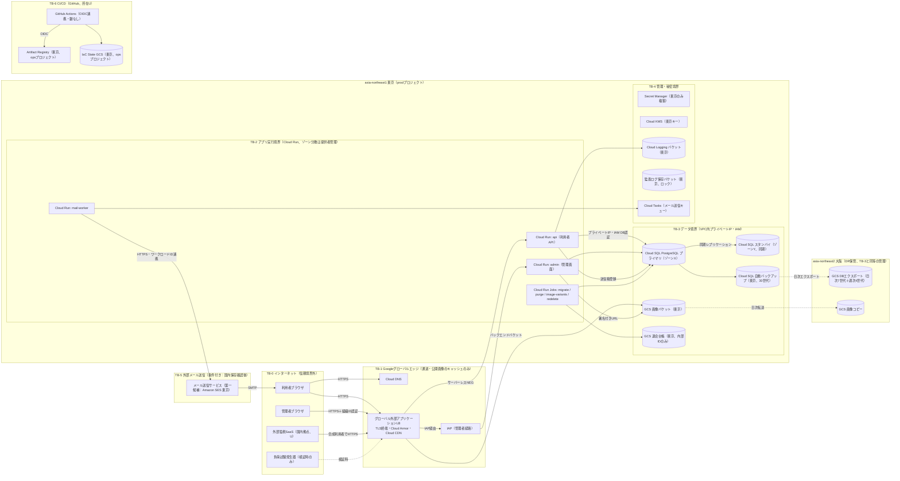

# クラウド設計書（2/4）：構成図・クラウド比較と選定・設計必須対象の採否

（目次は design.md 冒頭。本ファイルの価格・SLA・機能有無・クォータはすべて未確認（記憶ベース、確認日なし））

---

## 3. 構成図（経路・信頼境界・保存先・障害境界）

### 3.1 論理構成図（採用案：GCP）

### 3.2 公開経路と通信境界

| 経路ID | 送信元 → 宛先 | プロトコル・制御 | 備考 |
|---|---|---|---|
| P-01 | 利用者 → LB（動的API） | HTTPS（TLS1.2以上、HSTS）、Cloud Armor（事前構成WAFルール、レート制限）、個人応答は `Cache-Control: private, no-store` | 公開IPはLBのフロントエンドのみ |
| P-02 | 利用者 → LB → CDN → GCS（画像） | HTTPS、署名なし公開読取（画像は管理者作成コンテンツで個人情報なし）、バケットは直接公開せずLB経由 | キャッシュは提供者のグローバルエッジ（T-06） |
| P-03 | 利用者 → LB（公開一覧/詳細API） | 匿名応答のみ60秒CDNキャッシュ。認証クッキー付き要求はキャッシュキー外/非キャッシュ | 個人化された一覧（お気に入り表示）は別API・非キャッシュ |
| P-04 | 管理者 → LB → IAP → admin | 組織IDの2段階認証（セキュリティキー推奨）、IAP署名ヘッダをアプリで検証 | 管理画面はSLO対象外・監視対象 |
| P-05 | LB → Cloud Run | サーバーレスNEG。Cloud Runの受信設定は「内部＋Cloud Load Balancing」のみ（*.run.app直アクセス不可） | 未確認（記憶ベース、確認日なし）の機能。C工程で確認 |
| P-06 | Cloud Run → Cloud SQL | VPC直接送信（プライベート範囲のみVPC経由）、プライベートIP、IAMデータベース認証、TLS | DBパスワード不要 |
| P-07 | mail-worker → メール送信サービス | HTTPS API、ワークロードID連携（長期鍵なし）。宛先・件名・本文のみ送信、本文に氏名等を入れない最小化 | Q-09の確認後に確定 |
| P-08 | Cloud SQL → 大阪GCS | 提供者内部のエクスポート。CMEK（大阪キー） | 国内2リージョン間 |
| P-09 | GitHub Actions → GCP | OIDCによるワークロードID連携。サービスアカウント鍵は組織ポリシーで作成禁止 | CIログの公開範囲はQ-20 |

### 3.3 信頼境界

| 境界 | 範囲 | 境界の制御 |
|---|---|---|
| TB-0 | インターネット | 信頼しない。すべての入力を検証 |
| TB-1 | 提供者エッジ（LB、CDN、Armor、IAP） | 設定はIaCのみで変更。個人情報を保存させない（キャッシュ制御） |
| TB-2 | アプリ実行（Cloud Run） | サービスごとの専用サービスアカウント、最小権限。受信はLB経由のみ |
| TB-3 | データ（Cloud SQL、GCS） | パブリックIPなし（組織ポリシー）、バケット公開アクセス防止（画像バケットはLBのバックエンドとして読取のみ許可）、CMEK、データアクセス監査ログ |
| TB-4 | 管理・秘密（Secret Manager、KMS、ログ、監査） | 管理者グループのみ。破棄・権限変更は監査。ブレークグラス手順 |
| TB-5 | 外部メール送信 | 送信専用の権限、送信元ドメイン認証（SPF/DKIM/DMARC）、送信データ最小化 |
| TB-6 | CI/CD（GitHub） | OIDC、保護ブランチ、本番適用は承認必須、秘密情報スキャン |

### 3.4 保存先一覧（REQ-08の証跡単位）

| 保存先ID | データ | 場所 | 暗号化 | 保持 |
|---|---|---|---|---|
| S-01 | 業務データ（会員、認証情報＝パスワードハッシュ・セッション、プロフィール、お気に入り、コンテンツ、送信箱） | Cloud SQL 東京（プライマリ・スタンバイとも東京内の別ゾーン） | 提供者暗号化＋CMEK（東京） | 稼働中。退会者は7日後物理削除（≦30日） |
| S-02 | DB自動バックアップ・PITRログ | 東京（バックアップ所在地を明示指定。既定のマルチリージョンを使わない） | 同上 | 自動バックアップ30世代、PITR7日（≦35日） |
| S-03 | DBエクスポート（DR用） | GCS 大阪 | CMEK（大阪） | 日次7世代＋週次4世代、ライフサイクルで35日以内に削除 |
| S-04 | 画像（原本・派生） | GCS 東京、複製を大阪 | 提供者暗号化 | 稼働中。旧版/削除済みは30日で完全削除 |
| S-05 | 退会台帳（内部ID、退会時刻、削除完了時刻） | GCS 東京（DBとは別保存） | CMEK | 40日（バックアップ最大保持35日＋余裕5日）後に削除 |
| S-06 | アプリ・アクセス・WAFログ | Cloud Logging 東京バケット | 提供者暗号化 | 30日（Q-11） |
| S-07 | 監査ログ（管理操作、データアクセス） | Cloud Logging 東京（組織既定の保存場所を東京に設定）＋保持ロックしたバケット | 提供者暗号化 | 400日（Q-11）。提供者固定保持バケットの所在設定可否は未確認（記憶ベース、確認日なし） |
| S-08 | 秘密情報（セッション署名鍵、外部APIの設定値） | Secret Manager（東京のみ複製の指定） | 提供者暗号化＋CMEK | 版管理、旧版は無効化後削除 |
| S-09 | コンテナイメージ | Artifact Registry 東京 | 提供者暗号化 | 直近20版 |
| S-10 | IaC State | GCS 東京（opsプロジェクト）、版管理 | CMEK | 版管理90日 |
| S-11 | メール送信ログ・抑止リスト | 外部サービス側（第一候補なら東京） | 提供者 | 提供者仕様（U、Q-09） |
| S-12 | 外部監視の結果 | 外部監視SaaS（所在U） | 提供者 | 合成利用者のみで実データなし |
| S-13 | 請求データ | 課金エクスポート（東京のデータセット） | 提供者暗号化 | 13か月 |

### 3.5 障害境界

| 障害境界ID | 単位 | 影響範囲 | 対策 | 本設計での扱い |
|---|---|---|---|---|
| FD-1 | コンテナインスタンス（プロセス） | 処理中の要求 | 最小2インスタンス、ヘルスチェック、自動再起動 | REQ-10対象・自動復旧 |
| FD-2 | 実行基盤（Cloud Runのホスト・ゾーン内基盤） | 当該インスタンス群 | 提供者による再配置 | REQ-10対象・自動復旧 |
| FD-3 | DBインスタンス | 全書込・読取 | HA自動フェイルオーバー（同期レプリカ） | REQ-10/11対象・自動復旧 |
| FD-4 | ゾーン（AZ） | ゾーン内の計算資源・DBプライマリ | Cloud Runのゾーン分散（提供者管理）、Cloud SQL HA | REQ-10/11対象・自動復旧。全面障害の実測不能 |
| FD-5 | リージョン（東京） | 全機能 | 大阪へのバックアップ保管＋IaC再構築（Tier0） | 30分/5分の範囲外（REQ-24） |
| FD-6 | グローバル層（LB、CDN、Armor、DNS、IAM） | 全機能 | 提供者依存。代替なし | 依存基盤障害としてSLOに算入。設計上の単一障害点として明記 |
| FD-7 | 外部依存（メール送信、外部監視、GitHub） | 登録確認・再設定メール／監視／デプロイ | 送信箱による遅延吸収、監視の多重化 | SLO対象外（メール）だが監視・復旧対象 |
| FD-8 | 論理障害（誤削除・破損・不正な変更） | データ | PITR、バックアップ、版管理 | REQ-23（人手、開始判断から4時間） |

---

## 4. クラウド比較と選定

### 4.1 同一比較条件（3社に共通適用）

| 条件ID | 条件 | 由来 |
|---|---|---|
| EC-01 | 同じ負荷モデル（1.6）、同じデータ容量モデル（1.7）、同じ費用算定量（7.2） | REQ-05/07/12 |
| EC-02 | 国内2リージョン（東京主、大阪副）が存在し、本番データ・バックアップ・ログを国内に保存できること | REQ-08 |
| EC-03 | 計算資源とDBがゾーン冗長で、REQ-10対象障害に人手なしで自動復旧できること | REQ-10/11/13 |
| EC-04 | CDN＋マネージドWAFルール（OWASP系の既製ルールとレート制限）を備えた公開経路 | 5.4 |
| EC-05 | 計算資源・DBにパブリックIPを持たせない（公開LBを除く） | 5.4（Cの変更シナリオにも備える） |
| EC-06 | 利用者認証は「国内保存が確認できるマネージド認証」または「アプリ内実装」。国内保存不明のマネージド認証は採用しない | REQ-08/16 |
| EC-07 | 環境は本番＋常設開発（最小）＋一時的検証環境。同じ監視・セキュリティ基準 | REQ-12/18 |
| EC-08 | 価格は公開単価（従量）で算定し、無料枠・クレジット・長期契約割引・確約利用割引を適用しない | REQ-12 |
| EC-09 | Aで指定されたAWSの事情（A工程の製品選択・制約）を前提に含めない | REQ-01 |
| EC-10 | 価格・機能・SLAは未確認（記憶ベース、確認日なし）として同じ確度で扱う | 作業指示 |

### 4.2 各社の対応サービス（比較用の参照構成）

| 機能 | AWS | Azure | GCP |
|---|---|---|---|
| 主リージョン/副リージョン | 東京 / 大阪 | 東日本 / 西日本（西日本のゾーン対応はU） | 東京 asia-northeast1 / 大阪 asia-northeast2 |
| CDN＋WAF | CloudFront＋AWS WAF（マネージドルール） | Front Door（マネージドルールはPremiumが必要と記憶）またはApplication Gateway WAF v2 | Cloud CDN＋Cloud Armor Standard（事前構成WAFルール） |
| 負荷分散 | ALB（CloudFront VPCオリジンで内部ALB化が可能と記憶） | Front Door → Container Apps | グローバル外部アプリケーションLB＋サーバーレスNEG |
| 実行基盤 | ECS on Fargate（2AZ以上） | Container Apps（ゾーン冗長環境） | Cloud Run（リージョナル、ゾーン分散は提供者管理） |
| 外向き通信（パブリックIPなし） | NATゲートウェイ×2（AZごと）またはVPCエンドポイント群 | 環境既定の外向き経路（NAT不要と記憶） | プライベート範囲のみVPC経由、それ以外は提供者経路（NAT不要） |
| DB | RDS for PostgreSQL Multi-AZ（またはAurora） | Azure Database for PostgreSQL フレキシブルサーバー ゾーン冗長HA（BurstableはHA不可と記憶） | Cloud SQL for PostgreSQL Enterprise HA |
| オブジェクトストレージ | S3（大阪へ複製） | Blob（ZRS、西日本へ複製） | GCS（大阪へ複製） |
| マネージド認証 | Cognito（東京リージョンにユーザープール） | Entra External ID（国内保存はU） | Identity Platform（国内保存はU） |
| メール | SES（東京） | Azure Communication Services Email（国内保存はU） | 第一者サービスなし（外部サービスが必要） |
| 秘密・鍵 | Secrets Manager、KMS | Key Vault | Secret Manager、Cloud KMS |
| 監視・ログ | CloudWatch、Synthetics | Azure Monitor、Log Analytics、Application Insights | Cloud Monitoring、Cloud Logging、Cloud Trace |
| 脅威検知・構成監査 | GuardDuty、Security Hub、Config | Defender for Cloud | Security Command Center（Standard層の範囲はU） |
| 所在地制限 | Organizations SCP | Azure Policy（許可リージョン） | 組織ポリシー（資源所在地制約） |
| 障害注入 | Fault Injection Service（AZ障害シナリオがあると記憶） | Chaos Studio | 利用者によるゾーン障害注入手段は限定的（DB手動フェイルオーバー、インスタンス停止等） |

上表の製品機能・対応状況はすべて未確認（記憶ベース、確認日なし）。

### 4.3 評価方法

1. P0要件に直結する4項目を**ゲート**（満たさない候補は不採用または条件付き）とする：G1 国内保存、G2 夜間無人での自動復旧（REQ-10対象）、G3 予算適合（余裕込み）、G4 マネージドWAFルールを予算内で利用可能。
2. ゲート通過候補を、運用負担、障害の検証可能性、ロックイン・撤退負担、成長対応、学習・引継ぎの観点で比較する（定性：◎優位、○可、△懸念、×不適合）。点数化はしない。
3. 価格は未確認のため、ゲートG3は為替150/165/180円の3点で判定し、差が小さい場合は「価格確認後に再判定」とする。

### 4.4 ゲート評価

| ゲート | AWS | Azure | GCP |
|---|---|---|---|
| G1 国内保存 | ◎ 認証（Cognito東京）・メール（SES東京）を含め第一者サービスで国内完結できる見込み（未確認（記憶ベース、確認日なし）） | △ マネージド認証・メールの国内保存がU。アプリ内認証なら回避可、メールは外部サービス要確認 | ○ 認証はアプリ内実装で国内完結。メールは第一者なし→外部サービスの国内保存確認が条件（Q-09）。ログ既定保存場所・DBバックアップ既定所在の設定が必須（設定漏れリスク） |
| G2 自動復旧 | ○ ECS複数AZ＋RDS Multi-AZ自動フェイルオーバー | ○ Container Appsゾーン冗長＋PostgreSQLゾーン冗長HA | ○ Cloud Runゾーン分散（提供者管理）＋Cloud SQL HA |
| G3 予算（同一条件、7.4） | △〜× 約667 USD/月→税込約11.0万円（150円時）。同一条件では超過見込み。計算資源にパブリックIPを許容しNAT削除すれば約9.5万円（150円）だがEC-05を満たさず、165円以上で超過 | × マネージドWAFルールのためFront Door Premiumを含めると約1,040 USD/月（税込約17.2万円）。WAFを独自ルールのみに下げても約12.3万円 | ○ 約480 USD/月→税込約7.9万円（150円）、約9.5万円（180円） |
| G4 WAF | ○ AWS WAFマネージドルールが低額 | × マネージドルールにPremium層が必要（月額固定費が大きい）と記憶 | ○ Cloud Armor Standardで事前構成WAFルールを従量利用 |
| 判定 | 条件付き（G3不適合見込み。価格確認で逆転の可能性あり） | 不採用（G3・G4） | 通過（G1は条件付き：Q-09） |

金額はすべて未確認（記憶ベース、確認日なし）。内訳は7.4。

### 4.5 ゲート以外の比較

| 観点 | AWS | Azure | GCP | 備考 |
|---|---|---|---|---|
| 運用負担（専任1名） | △ VPC・サブネット・NAT・ALB・ターゲットグループ・タスク定義など管理対象が多い | ○ Container Appsは比較的簡素 | ◎ Cloud RunはVPC直接送信の設定のみでNAT・サブネット設計が最小 | REQ-13/14。経験不足だけで判断せず、管理対象数と障害時の判断点の数で比較 |
| 障害の検証可能性（REQ-10の実測） | ◎ AZ障害の擬似注入手段がある見込み | ○ Chaos Studio | △ ゾーン障害の利用者側注入は不可。DBフェイルオーバーとインスタンス障害は実測可能 | GCP採用時は「単一AZ全面障害は未検証」と明記（6.2） |
| DB保守による計画停止 | ○ Multi-AZはスタンバイ先行適用＋フェイルオーバー（1〜2分程度と記憶） | ○ 同様 | ○ Enterpriseで1分前後と記憶、Enterprise Plusはほぼ無停止と記憶（高額） | すべて未確認（記憶ベース、確認日なし）。99.9%に算入（T-02） |
| ロックイン・撤退 | ○ PostgreSQL・コンテナは可搬。Cognitoを使う場合はパスワードハッシュの持出し不可と記憶（撤退時に再設定が必要） | ○ 同様 | ○ PostgreSQL・コンテナ（Cloud Runはコンテナ契約が標準的）で可搬。IAP・Cloud Armor・LB設定はIaC書き換えが必要 | 8.7 |
| 成長（10倍ピーク・100万人） | ○ | ○ | ○ Cloud Runの水平拡張は自動。DB接続数が先に制約（8.6） | いずれもDB増強が主費用 |
| 学習・引継ぎ | ○ 情報量が多い | ○ | ○ 構成要素が少なく引継ぎ文書が短い | 開発者5名はWeb/GitHub経験。いずれもコンテナとPostgreSQLの知識が中心 |
| メール | ◎ 第一者（SES東京） | △ 国内保存U | △ 第一者なし。外部サービス依存（クロスクラウド連携の運用が増える） | メールはSLO対象外（REQ-09）だが登録確認・再設定に必要 |

### 4.6 選定結果

**採用：GCP（東京 asia-northeast1 主、大阪 asia-northeast2 副）**（設計判断 D-01）

採用理由：
1. 同一条件（EC-01〜10）でP0の予算ゲート（G3）を3つの為替水準すべてで満たす唯一の候補である（150円/USDで税込約7.9万円、180円/USDで約9.5万円。未確認（記憶ベース、確認日なし））。ただし180円時の余裕は約5%と小さく、7.5の調整案を併せて承認対象とする。
2. 計算資源・DBにパブリックIPを持たせずにNATを不要にでき、構成要素が少ないため専任1名の運用負担が小さい（REQ-13/14）。
3. マネージドWAFルールを従量で利用でき（G4）、Cloud Run＋Cloud SQL HAでREQ-10対象障害に自動復旧できる（G2）。
4. 主要データはPostgreSQLとコンテナで保持し、撤退負担を抑えられる（8.7）。

受け入れるトレードオフ：
- 利用者認証をアプリ内実装とするため、パスワード保管・再設定・ブルートフォース対策の設計/実装責任を自社が負う（6.4で対策）。
- メール送信に第一者サービスがなく、外部サービス（第一候補はAWS SES東京のクロスクラウド利用）に依存する。運用対象のアカウントが1つ増える。
- 単一AZ全面障害を利用者側で注入して実測できない（6.2で未検証として扱う）。
- ログの既定保存場所、DBバックアップの所在を明示設定しないと国外に保存され得る（設定漏れを組織ポリシーと検証V-07で防ぐ）。

**次点：AWS**（条件付き）。不採用理由：同一条件（計算資源パブリックIPなし）での概算が税込約11.0万円（150円時）で予算超過見込み。主因はAZごとのNATゲートウェイ、ALB固定費、脅威検知サービス群。国内保存の観点ではAWSが最も確実であり、価格確認で逆転し得る差である。

**不採用：Azure**。不採用理由：同一条件のマネージドWAFルールを満たす構成（Front Door Premium等）が予算を大きく超過し（G3/G4）、マネージド認証・メールの国内保存もU（G1）。

### 4.7 再選定条件（見直し条件）

以下のいずれかに該当した場合、選定を再評価する（再評価は要件所有者の承認を得てから行う）。

| ID | 条件 | 再評価の方向 |
|---|---|---|
| RS-01 | GCP側でメール送信の国内保存を満たす手段が確認できない（Q-09） | AWS（SES東京を第一者として利用）へ再選定、またはメール機能の要件調整を意思決定 |
| RS-02 | 公式価格で再計算し、GCP案とAWS案（同一条件）の差が月額10%未満、かつAWS案も余裕10%以上で予算内 | 国内保存の確実性と障害注入の検証可能性を重視しAWSを再比較 |
| RS-03 | 公式価格で再計算し、GCP案が為替165円/USDで予算の90%を超える | 調整案（7.5）を提示し、満たせなければ要件調整を意思決定 |
| RS-04 | ログの既定保存場所・監査ログの所在を国内に固定できないことが判明（S-07） | 所在要件の解釈確認（Q-08/11）、不可ならAWS再評価 |
| RS-05 | 単一AZ障害の実測が受入条件として必須と決定（Q-06関連） | AZ障害注入手段のある候補を再比較 |
| RS-06 | Microsoft連携・既存契約等の新たな優先条件の発生 | 条件を追加して3社を再比較 |

---

## 5. 設計必須対象ごとの採否

各項目に「採否・理由・代替案・見直し条件」を記載する。

### 5.1 クラウド選定（D-01）

| 項目 | 内容 |
|---|---|
| 採否 | GCPを採用（東京主・大阪副）。AWS次点、Azure不採用 |
| 理由 | 4.4〜4.6 |
| 代替案 | AWS（ECS Fargate＋RDS Multi-AZ＋CloudFront/WAF＋Cognito/SES）。マルチクラウド分散（本体を複数社に分散）は運用負担と費用から不採用 |
| 見直し条件 | 4.7 RS-01〜06 |

### 5.2 VM/コンテナ/Serverless、Kubernetesの必要性（D-02、D-03）

| 項目 | 内容 |
|---|---|
| 採否 | **Cloud Run（コンテナのサーバーレス実行）を採用**。サービス：api（利用者API・SSR/静的配信の有無はアプリ設計に依存）、admin（管理画面）、mail-worker。ジョブ：migrate（DBスキーマ）、purge（退会者物理削除）、redelete（復元後再削除）、image-variants（画像派生生成）。**VM不採用、Kubernetes（GKE Standard/Autopilot）不採用** |
| 理由 | (1) 負荷規模（通常10件/秒、ピーク100件/秒）は少数インスタンスで処理できる見込み（A-29、V-05で確認）。(2) OSパッチ・ノード管理が不要で専任1名の負担が小さい。(3) リビジョン単位の段階的トラフィック移行とロールバックが標準機能。(4) ゾーン分散が提供者管理で、ゾーン障害時に人手を要しない。(5) Kubernetesはクラスタ・ノード・アップグレード・ネットワークポリシー等の運用対象が増え、本規模・本体制では便益が費用と運用負担を上回らない。経験不足だけを理由とせず、必要機能（サイドカー、独自スケジューリング、多数サービス）がないことを主理由とする |
| 設定方針 | 最小インスタンス2（コールドスタート回避とゾーン分散の前提）、最大インスタンス10（DB接続上限保護。8.6で拡張）、同時実行数は負荷試験で決定（初期40）、起動時CPUブースト、CPU 1/メモリ2GiB（ログインのArgon2idのメモリ使用を考慮）、要求タイムアウト10秒、スタートアップ/ライブネスプローブ |
| 代替案 | (a) GKE Autopilot：多数サービス化時に検討。(b) Compute Engine MIG（VM）：OS管理負担大。(c) Cloud Run functions：単機能の非同期処理には利用可（メール送信等）だが本体APIはコンテナで統一 |
| 見直し条件 | サービス数が10を超える、Cloud Runの制約（要求タイムアウト、接続方式、ローカル状態）に抵触する機能が追加される、1,000件/秒以上の常時負荷でインスタンス課金がGKEより高くなる（8.6）、チームにKubernetes運用要員が確保される |

### 5.3 SQL/NoSQL、整合性、容量、接続数、拡張（D-04、D-05）

| 項目 | 内容 |
|---|---|
| 採否 | **Cloud SQL for PostgreSQL（Enterprise版、HA＝リージョナル構成：プライマリと同期スタンバイを東京の別ゾーンに配置）を採用**。初期1vCPU/3.75GB、SSD 50GB（自動拡張あり）、プライベートIPのみ、IAMデータベース認証、CMEK。読取レプリカ・Memorystore（Redis）は初期不採用 |
| 理由 | (1) 会員のメール一意性、お気に入りと会員・コンテンツの関連、管理者更新のトランザクション、退会時の一括削除など関係データ・制約が中心。(2) 本人の次回参照への反映（REQ-02）をプライマリ読取の強い整合性で単純に満たせる。(3) 同期レプリケーションによりREQ-11のRPOを満たしやすい。(4) PostgreSQLは他社・自前にも移行可能 |
| 整合性 | 利用者の参照・更新はすべてプライマリで処理（読取レプリカを使わない）。公開コンテンツ一覧/詳細のみCDN短期キャッシュ（60秒、管理者更新時は無効化要求）。お気に入りは（会員ID、コンテンツID）一意制約で二重登録を防止 |
| 容量 | 初期20GB→3年92GB（1.7）。ストレージ自動拡張、使用率70%で通知 |
| 接続数 | 接続上限は提供者の既定値がメモリ量依存でU（未確認（記憶ベース、確認日なし））。アプリ側で「最大インスタンス10×プール5＝50」＋admin5＋ジョブ5＝60を上限とし、DB上限の80%以内に収まることをC工程で確認 |
| 拡張 | 縦拡張（2vCPU/8GB→4vCPU/16GB、再起動を伴い数分の停止が発生し得る：未確認（記憶ベース、確認日なし））、読取レプリカ（公開コンテンツ用）、接続プーラー、キャッシュの順で検討（8.6） |
| 代替案 | (a) Firestore（NoSQL、ゾーン/リージョン冗長、接続数制約なし）：関係制約・集計・移行可搬性で劣るため不採用。(b) Cloud SQL Enterprise Plus：保守停止がほぼ無いと記憶、ただし最小構成の単価が高く予算圧迫。(c) AlloyDB：高性能だが本規模に過剰で費用大。(d) 自前PostgreSQL on VM：運用負担大 |
| 見直し条件 | DB CPU p95>60%が1時間継続、接続数>上限の70%、計画停止が月間誤差予算の25%（約11分）を超える、10倍ピーク試験でp95>500ms（DB起因）、会員関連データが会員数比例と判明（Q-13） |

### 5.4 単一障害点、Multi-AZ/Multi-Region（D-06、D-15）

| 項目 | 内容 |
|---|---|
| 採否 | **Multi-AZ（マルチゾーン）を採用、Multi-Region（アクティブ構成）は不採用**。大阪にはDBエクスポートと画像の複製を保管し、IaCで再構築可能にする（Tier0） |
| 単一障害点の一覧と扱い | (1) グローバルLB/CDN/Armor/DNS：提供者のグローバル層。代替なし、依存基盤障害としてSLOに算入。(2) 東京リージョン：Tier0で対応、30分/5分の範囲外。(3) DBプライマリ：HAで解消。(4) 専任1名：副担当育成（8.5）。(5) メール送信サービス：送信箱で遅延吸収、SLO対象外。(6) GitHub：障害時はデプロイ不可だが稼働中サービスは影響なし。(7) 組織管理者アカウント：ブレークグラス2本 |
| 理由 | 東京リージョン内の3ゾーン（未確認（記憶ベース、確認日なし））でREQ-10対象障害を自動復旧できる。アクティブ・スタンバイのマルチリージョンは費用が約2倍となり予算を超える |
| 代替案 | Tier1（大阪へクロスリージョン読取レプリカ）、Tier2（大阪にウォームスタンバイ）。6.3、7.6 |
| 見直し条件 | リージョン停止にRTO/RPOの保証が要件化された場合、予算拡大時、または東京リージョンの障害実績が要件所有者の許容を超えた場合 |

### 5.5 CDN、WAF、公開経路、通信境界（D-07、D-08）

| 項目 | 内容 |
|---|---|
| 採否 | **グローバル外部アプリケーションLB＋Cloud CDN＋Cloud Armor Standardを採用**。画像はGCSバケットをLBのバックエンドとしてCDN配信。動的APIはサーバーレスNEGでCloud Runへ。管理画面はIAP |
| WAF設定 | 事前構成ルール（SQLインジェクション、XSS、LFI、RCE、スキャナ検知等のOWASP系）を検知モードで2週間運用後に遮断へ移行。ログインAPIに送信元IP単位のレート制限（例：1分あたり20回）、登録APIに同様の制限。国別制限は行わない（国内向けだが海外在住日本語利用者の扱いはU） |
| 通信境界 | 計算資源・DBにパブリックIPなし（組織ポリシーでCloud SQLのパブリックIP禁止、外部IPを持つVMの作成禁止）。Cloud Runの受信は内部＋LBのみ。外向きはプライベート範囲のみVPC経由 |
| DDoS | LBの基本的なL3/L4防御は標準で含まれると記憶（未確認（記憶ベース、確認日なし））。適応型保護（Enterprise層）は費用から不採用 |
| 理由 | 画像転送200GB/月をCDNで吸収しオリジン負荷と転送費を抑制。WAF/レート制限で認証APIの総当たりと費用攻撃を抑制 |
| 代替案 | (a) 東京リージョナル外部LB（TLS終端を東京に固定、Cloud CDN不可）：「通過も国内」が要件化された場合（Q-08）。(b) 外部CDN事業者：運用対象と所在確認が増える。(c) Cloud Armor Enterprise：月額固定費が予算圧迫 |
| 見直し条件 | Q-08の回答、WAF誤検知率が業務に影響、ボット被害の発生（reCAPTCHA等の追加検討、外部送信の所在確認が必要）、Public IP禁止（C(4)）の範囲確定 |

### 5.6 個人情報保護、暗号化、秘密情報、IAM、監査（D-09〜D-13）

| 項目 | 採否・内容 | 理由 | 代替案 | 見直し条件 |
|---|---|---|---|---|
| 利用者認証（D-09） | アプリ内実装を採用。メール＋パスワード、Argon2id（パラメータは負荷試験で決定）、メール確認、再設定トークン（ハッシュ保存、30分有効、1回限り）、セッションは不透明トークンのHttpOnly/Secure/SameSite=Laxクッキー（DBにはハッシュを保存）、アカウント単位の段階的遅延、利用者MFA任意（TOTP） | 国内保存が確認できるマネージド認証がGCPにない（U）。認証データを業務DB（東京）に閉じる | Identity Platform（国内保存確認後）、外部IDaaS（所在確認要） | Q-10回答、マネージド認証の国内保存が確認できた場合、脆弱性診断で重大指摘 |
| 管理者認証 | IAP＋組織ID（2段階認証必須、セキュリティキー推奨）。アプリ側でIAP署名を検証し、管理者ロールを付与 | 管理画面をインターネットに直接露出しない | アプリ内管理者認証＋MFA | 管理者数増加、外部委託者の追加 |
| 暗号化（D-10） | 通信：TLS1.2以上（LB）、DB接続TLS。保存：提供者暗号化＋CMEK（Cloud SQL、エクスポート、退会台帳、State）。キーは自動ローテーション90日、破棄は予定破棄期間付き | 鍵操作の監査と権限分離 | 提供者管理鍵のみ（運用簡素） | CMEK起因の障害（鍵無効化）が発生、運用負担が過大 |
| 秘密情報（D-11） | Secret Manager（東京のみ複製）。DBはIAM認証でパスワード不要。サービスアカウント鍵は作成禁止。GitHubはOIDC連携。リポジトリは秘密情報スキャンとプッシュ保護 | 長期鍵の漏えい経路を排除 | — | 外部サービスで鍵必須の場合は90日ローテーション |
| IAM（D-12） | 組織配下にフォルダ、プロジェクト分離（prod、dev、ops、verify）。人はグループ単位付与。infra-admin（専任1名＋副担当）、developers（dev編集、prod閲覧のみ・データ参照不可）、auditors（ログ閲覧）、break-glass（2本、物理キー保管、使用時通知）。prodのデータ参照は期限付き付与（IAM条件の期限）と承認記録 | 最小権限と職務分離 | 個人単位付与（不採用） | 人員増、外部委託 |
| 組織ポリシー | 資源所在地を日本の2リージョンに制限、Cloud SQLパブリックIP禁止、SA鍵作成禁止、バケット公開アクセス防止・均一アクセス、外部IP付きVM禁止、ドメイン制限共有 | REQ-08の技術的担保 | 手順書による運用（不採用） | 提供者の新サービスが所在制約非対応の場合 |
| 監査（D-13） | 管理操作監査（常時）、データアクセス監査（Cloud SQL、Secret Manager、KMS、IAM、退会台帳バケット）を有効化。アプリの管理者操作（誰が・いつ・どのコンテンツを）をDBとログに記録。Cloud SQLは監査拡張でDDL・権限変更のみ記録（読取SQLは記録しない＝PIIをログに出さない） | 不正操作の追跡、REQ-16 | 全SQL記録（PII混入・費用増のため不採用） | 監査要件の追加、Q-11回答 |
| ログのPII対策 | 構造化ログを許可リスト方式で出力（要求本文・クッキー・認証ヘッダ・メールアドレスを出さない）。URLにメールやトークンを含めない設計。例外メッセージの値をマスク。ログベース指標でメール形式・トークン形式の文字列検知時に警報。CIでログ出力スキーマを試験 | 原則不記録の担保 | 有料の機密データ検出サービスの定期スキャン（費用U） | 検知件数>0、監査で指摘 |

### 5.7 Backup/DR、復元テスト、RTO/RPO（D-14、D-15）

| 項目 | 内容 |
|---|---|
| 採否 | Cloud SQL自動バックアップ（日次、30世代、東京指定）＋PITR（7日）を採用。大阪へ日次エクスポート（7世代）＋週次（4世代）。画像はオブジェクト版管理＋削除保護（30日）＋大阪複製。退会台帳でバックアップ復元後の再削除 |
| 理由 | 30世代でも35日上限内。PITRで論理破損の直前に戻せる。大阪のエクスポートはリージョン停止時の再構築用 |
| 復元テスト | 月次：最新バックアップから一時インスタンスへ復元（prodプロジェクト内の隔離環境、実データを他環境へ持ち出さない）→整合性確認→再削除ジョブ→計測→削除。四半期：PITR訓練（論理破損想定、4時間目標）。半期：大阪での再構築訓練（Tier0） |
| RTO/RPO | 6.2・6.3 |
| 代替案 | Cloud SQLのバックアップのみ（大阪エクスポートなし）：リージョン停止時に復旧手段がない。クロスリージョンレプリカ（Tier1） |
| 見直し条件 | 復元時間が4時間目標の50%を超える、DB容量が100GBを超える、Q-18回答 |

### 5.8 ログ、メトリクス、トレース、通知・対応（D-16）

| 項目 | 内容 |
|---|---|
| 採否 | Cloud Logging（東京バケット）、Cloud Monitoring（指標・警報・SLO・合成監視）、Cloud Trace（OpenTelemetry、10%サンプリング）、外部監視SaaS（国内拠点からの合成監視、費用・所在はU）を採用 |
| 理由 | 外部測定（REQ-09）は提供者内部の監視だけでは提供者障害時に同時に失われる可能性があるため、提供者外の計測を併用 |
| 通知 | 重大（P1）：チャット＋メール＋モバイルプッシュ。夜間も送信するが即応義務なし（REQ-13）。P2/P3は営業時間に対応 |
| 代替案 | 提供者内の合成監視のみ（独立性が不足）、APM商用製品（費用） |
| 見直し条件 | 外部監視SaaSの所在・費用が要件に合わない場合（代替：別クラウドの小規模定期実行環境で計測） |

### 5.9 初期・成長時費用、算定条件、変動要因

第7章で記載（算定条件、単価出典と確認状態、3社比較、為替・使用量感度、超過時の調整案、成長時費用）。

### 5.10 IaC、State、環境分離、CI/CD、ロールバック（D-20〜D-22）

第8章で記載。採否の要約：Terraform互換ツール（Terraform または OpenTofu。ライセンス方針は確認事項）を採用、StateはGCS（東京、版管理、ロック、CMEK）、環境ごとにState分離、GitHub Actions＋OIDC、本番適用は承認必須、Cloud Runリビジョンの段階移行と即時ロールバック。代替案：提供者のデプロイ管理サービス（Cloud Deploy等）、Pulumi。見直し条件：環境数増加、チーム拡大、ドリフト頻発。

### 5.11 専任1名で維持する運用体制（D-23）

第8章8.5で記載。要約：自動復旧を前提とし、人手が必要な作業は平日日中に限定。副担当（開発者1名）を育成し、ランブックで手順化。夜間は通知のみで、人の即応を前提にRTO適合と主張しない。

### 5.12 Vendor lock-in、移行・撤退負担（D-24）

第8章8.7で記載。要約：データ（PostgreSQL、画像オブジェクト）とアプリ（コンテナ）は可搬。ロックインはLB/CDN/Armor/IAP/IAM/監視設定に限定され、IaCの書き換えで対応。撤退時のデータ転送費は小さい（概算は8.7）。

（第6章以降は design-03.md に続く）
